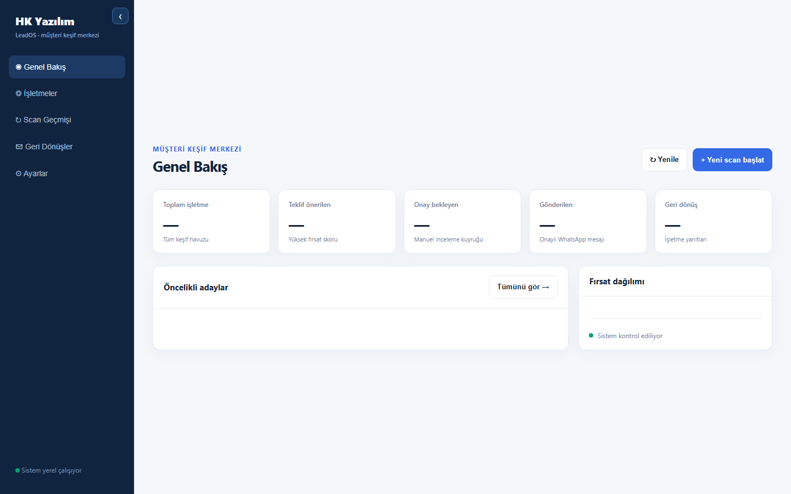
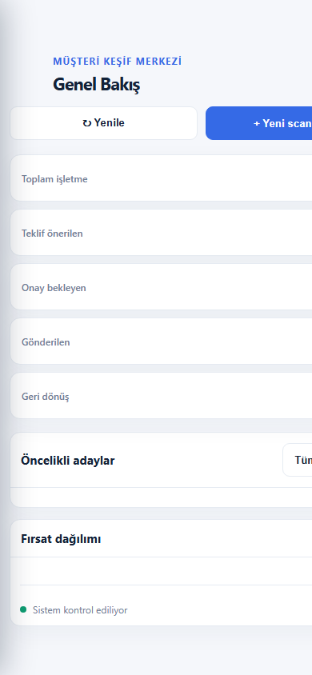

# HK LeadOS — AI-Powered B2B Lead Discovery & Digital Presence Audit

[](https://github.com/zynordev/hk-lead-os/actions/workflows/ci.yml)

**HK LeadOS** is a self-hosted, human-in-the-loop B2B lead discovery, website-audit, and mini-CRM platform built for web agencies and freelancers. It discovers local businesses in Turkey via **Apify Google Maps**, audits website health (SSL, mobile viewport, speed & redesign opportunities), searches the web to uncover **hidden websites, Meta Ad Library presence, and commission-based delivery platforms** (Yemeksepeti, GetirYemek, Trendyol Yemek, Migros Yemek, Uber Eats, Instagram, TripAdvisor), scores opportunities with **Gemini AI**, generates **one-click live demo websites**, and tracks deals on a **Dark Mode CRM Kanban board**.



---

## ✨ Key Features

- **🗺️ Geo-Locked Turkey Discovery (`lead_automation.py`):**
  - Automatically expands major Turkish city queries across key districts (İstanbul, Ankara, İzmir, Samsun, Antalya, Bursa, etc.) with strict `locationQuery` + `countryCode: "tr"` and coordinate/address/phone verification so foreign businesses are never mixed in.
- **🔎 Zero-Cost Web & Platform Presence Enricher (`lead_system/web_search.py`):**
  - Searches each business on the web to find:
    1. **Hidden official websites** missing from Google Maps (verified via live HTTP content checks).
    2. **Delivery & Ad Platforms:** Detects active listings on **Yemeksepeti, GetirYemek, Trendyol Yemek, Migros Yemek, Uber Eats, TıklaGelsin, Fuudy**, plus **Instagram, Facebook, TikTok, TripAdvisor, Foursquare**.
- **🧠 Deterministic + Gemini AI Scoring & Tailored Pitches (`lead_system/scoring.py`, `website_ai_worker.py`):**
  - Scores businesses with transparent rules (missing/broken site + active commission delivery platform + active Instagram = high opportunity) and generates personalized, non-spammy Turkish outreach drafts using Gemini (works standalone via REST API or via multi-worker `hk_agents`).
- **📊 Responsive Web Dashboard (`lead_system/dashboard.html`, `dashboard_server.py`):**
  - Zero-dependency Python HTTP server with live scan progress, platform badges, search/filter toolbar, detail modal, manual approval queue, and optional Google Sheets sync.
- **🔐 Defense-in-Depth Security:**
  - **SSRF Protection:** Blocks private, loopback, link-local, and cloud metadata IPs on both initial requests and HTTP `30x` redirects.
  - **Prompt Injection Defense:** Scraped web/Maps evidence is sanitized and strictly isolated as untrusted data.
  - **Human-in-the-Loop Outreach:** `whatsapp_sender` requires explicit manual approval, constant-time token verification (`crypto.timingSafeEqual`), and server ACK tracking.
  - **WebAuthn Passkey Gateway (`auth_gateway/`):** Optional FIDO2/Passkey reverse proxy with separate TTL-bound login/registration challenges.
  - **HTTP Security Headers & Safe Links:** Strict CSP, `X-Frame-Options: DENY`, `X-Content-Type-Options: nosniff`, and `http(s):`-only URL validation.

---

## 🏗️ Architecture

```text
Google Maps (Apify) ──► Turkey Geo-Filter ──► HTTP Website Audit (SSRF-safe)
                                                      │
                                                      ▼
Web Dashboard ◄── Atomic LeadStore ◄── Gemini AI Audit ◄── Web & Delivery Platform Search
 (127.0.0.1:8790)     (JSON / Sheets)      & Scoring          (Yemeksepeti, Getir, etc.)
       │
       ▼ (Manual Approval Only)
WhatsApp Bridge (127.0.0.1:8787) + Optional WebAuthn Passkey Gateway (127.0.0.1:8800)
```

---

## 🚀 Quick Start

### 1. Configure Environment
```bash
cp .env.example .env
# Add your APIFY_API_TOKEN and optional GEMINI_API_KEY
```

### 2. Start the Dashboard
```bash
python3 -m lead_system.run_dashboard
# Open http://127.0.0.1:8790
```

### 3. Run a CLI Scan (Dry-Run or Live)
```bash
# Dry-run (inspect search variations without calling Apify)
python3 lead_automation.py --query "istanbul burgerci" --dry-run

# Live scan
export APIFY_API_TOKEN="your_apify_token"
export GEMINI_API_KEY="your_gemini_key"
python3 lead_automation.py --query "istanbul burgerci" --limit 20
```

---

## 📱 Mobile View

<p align="center">
  
</p>

---

## 📄 License

MIT License — see [LICENSE](LICENSE) for details.
